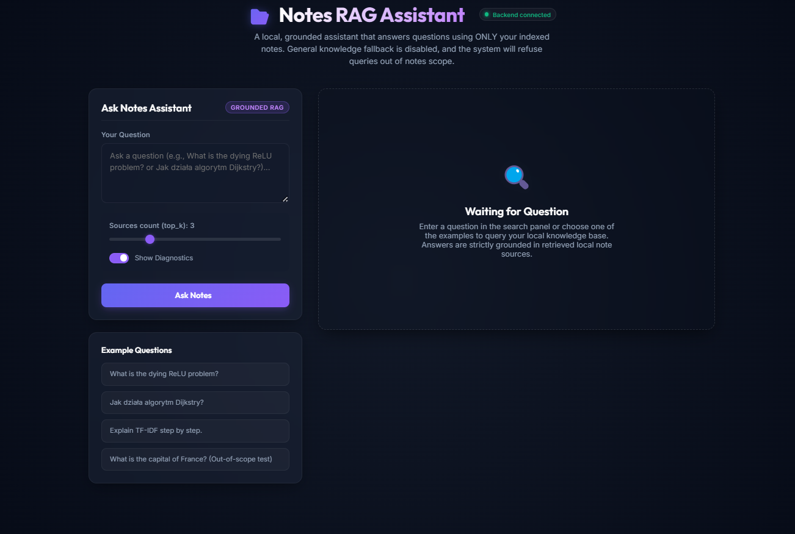
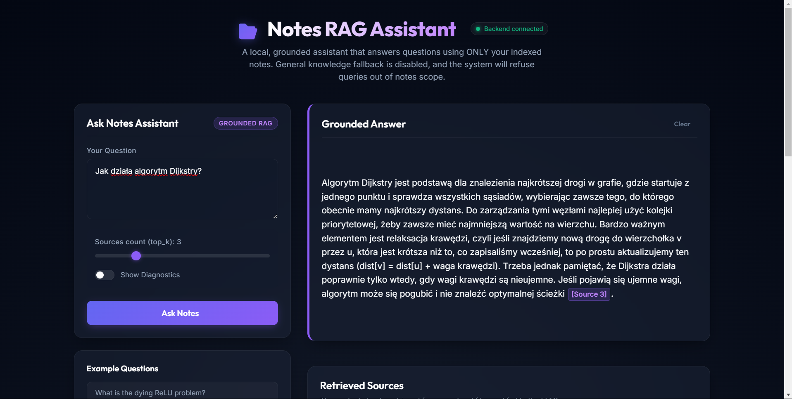
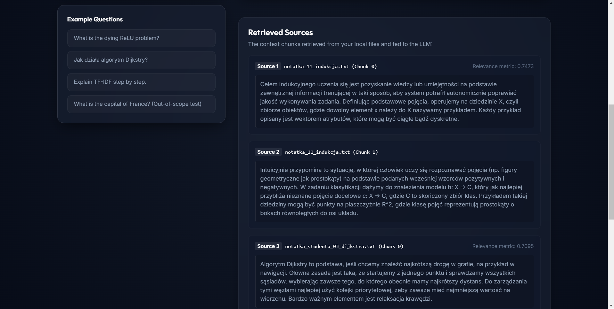
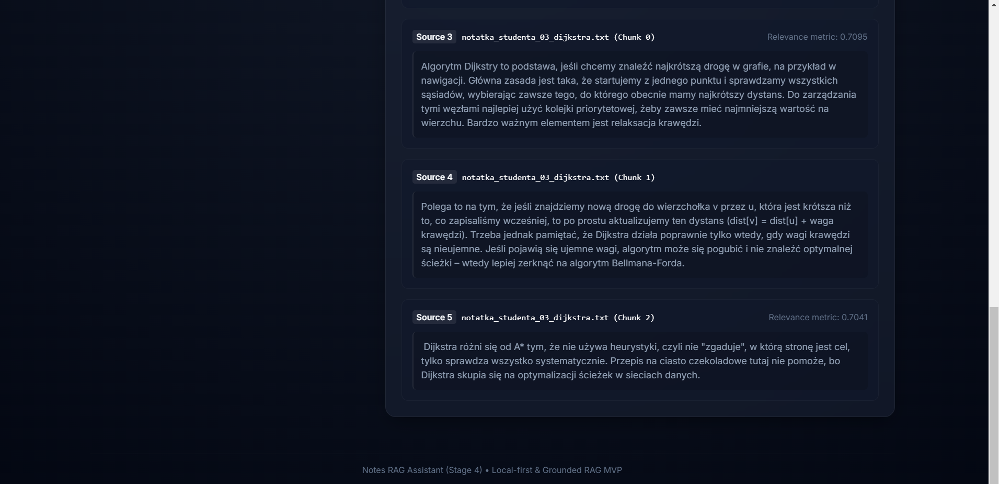
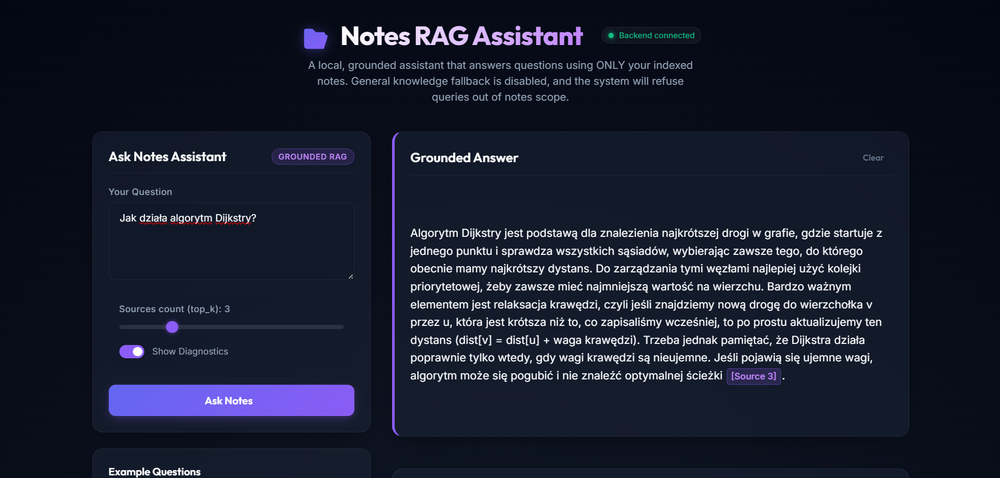
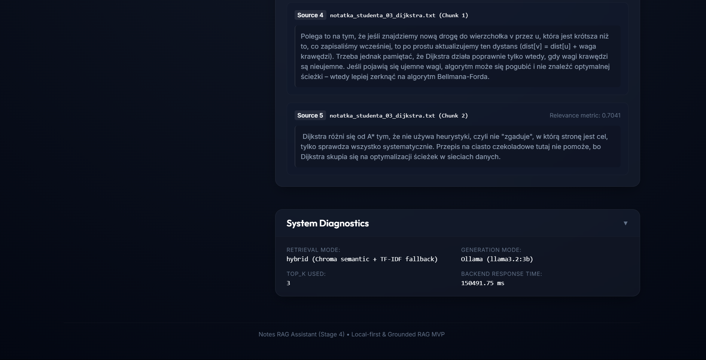
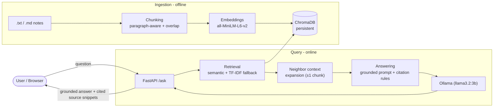

# Notes RAG Assistant

> A local-first, **grounded** question-answering assistant over your own study notes. It is a grounded notes assistant, not a general chatbot, designed to answer with source citations (returning cited source snippets when answering). It answers **only** from indexed notes — no external-knowledge fallback. If the answer isn't in the notes, it refuses instead of hallucinating.


Repository: https://github.com/kat1478/notes-rag-assistant

---

## Demo screenshots

- **App Home Screen**: The main query interface showing connection status.
  
- **Answer with Sources**: Grounded answer output with highlighted interactive citations.
  
  
  
- **Diagnostics Panel**: Real-time insights showing retrieval latency, similarity scores, and LLM parameters.
  
  

---

## Why this project

This is a full Retrieval-Augmented Generation (RAG) pipeline built from scratch to explore a deliberately
hard constraint: **answers are designed to be grounded in the source notes, returning cited source snippets when answering, or the system must refuse if the information is not present.**
The notes are a mix of English and Polish CS/ML study notes, which surfaces real cross-lingual retrieval
challenges that are documented in the [Known Limitations](#known-limitations) section.

The project is built in stages, each with its own evaluation pass — retrieval quality, answer quality, and a
final validation run on previously unseen notes.

---

## Current status

The application is fully local-first, runs on local Ollama, has no external dependencies/API keys, and is fully functional for query serving and evaluation.

---

## Architecture



**Pipeline:** `FastAPI → chunking → embeddings → ChromaDB → retrieval (+ neighbor expansion) → Ollama (llama3.2:3b) LLM → grounded answer with source citations`

| Layer | Component |
| :--- | :--- |
| API | FastAPI (`/ask`, `/search`, `/ingest`, `/ingest/batch`, `/health`) |
| Chunking | Paragraph-aware with character-level fallback and overlap |
| Embeddings | `sentence-transformers` — `all-MiniLM-L6-v2` |
| Vector store | ChromaDB (persistent, per-file upsert/delete) |
| Retrieval | Semantic (Chroma) with TF-IDF fallback + 1-hop neighbor context expansion |
| Generation | Ollama (local model `llama3.2:3b`), `temperature = 0.0`, strict grounding prompt |
| Frontend | Vanilla HTML/CSS/JS with clickable citations and a diagnostics panel |

---

## Quickstart

### 1. Prerequisites
- Python 3.10+
- [Ollama](https://ollama.com/) installed and running locally

### 2. Setup Ollama
Start Ollama on your machine and run the following command to pull the required Llama 3.2 3B model:
```bash
ollama pull llama3.2:3b
```

### 3. Install
```bash
git clone https://github.com/kat1478/notes-rag-assistant.git
cd notes-rag-assistant/backend
pip install -r requirements.txt
```

### 4. Add and Ingest Notes
This system is local-first and API-key-free (no `.env` file or OpenRouter keys required). 
Drop your `.txt` or `.md` study notes into the directory:
```
backend/data/notes/
```
After dropping the notes, they must be ingested into the vector database by running the following command inside the `backend/` directory:
```bash
python -m app.run_retrieval_eval --reset-and-reingest
```

### 5. Run the Backend
Start the FastAPI server:
```bash
python -m uvicorn app.main:app --host 127.0.0.1 --port 8000
```

### 6. Open the App
Navigate to **http://localhost:8000/** in your browser. The root URL automatically redirects to the static frontend. Verify the **"Backend connected"** status indicator in the header (green dot).

### 7. Run the Smoke Test
To verify the complete pipeline, run the smoke test:
```bash
python smoke_test.py
```

### 8. Verification
The smoke test has been executed and passed successfully. Example output from the run:
```
Starting Stage 4 Smoke Test against http://127.0.0.1:8000...

[PASS] GET /health - Model: llama3.2:3b
[PASS] GET / - Resolved URL: http://127.0.0.1:8000/frontend/
[PASS] GET /frontend/ - HTML loaded successfully
Sending POST /ask ('What is ReLU?')... (LLM inference may take 5-20 seconds)
[PASS] POST /ask - Answer length: 132 chars, time: 46614.58 ms

--- Summary ---
All smoke tests PASSED!
```

---

## Example

**In-scope question — answered with source citations:**

> **Q:** What is Dijkstra's algorithm used for?
>
> **A:** Dijkstra's algorithm jest używany do optymalizacji ścieżek w grafach, czyli do znalezienia
> najkrótszej drogi między dwoma wierzchołkami. **[Source 1]**

The UI renders each retrieved chunk as a source card; clicking a `[Source N]` badge scrolls to and
highlights the matching note.

**Out-of-scope question — refused instead of guessed:**

> **Q:** What is the capital of France?
>
> **A:** I don't have enough information to answer that based on the notes.

---

## Evaluation

Evaluation is a first-class part of this project. Datasets and execution metrics are tracked under [`backend/data/eval/`](backend/data/eval/).

### a) Main Benchmark (After Stage 3D)
Evaluated on the 32-query benchmark dataset containing 30 in-scope (grounded) questions and 2 out-of-scope questions (measured on the final system with Ollama `llama3.2:3b` on CPU):

| Metric | Result | Details / Notes |
| :--- | :---: | :--- |
| **Grounded (In-Scope) Answering Rate** | 100.0% | 30/30 (final system) |
| **Out-of-Scope Correct Refusal Rate** | 100.0% | 2/2 |
| **Source Citations Rate (On Answered)** | 93.3% | 28/30 |
| **Average Response Time** | ~39.0 s | 38,964.5 ms on CPU |
| **Retrieval Hit Rate** | 100.0% | 30/30 |
| **First Hit Correct Rate** | 90.0% | Baseline was 83.3% |

### b) Validation on Unseen Notes
Validation pass performed on a held-out set of previously unseen notes (`notatka_11`–`notatka_15`) to test generalization capability:

| Metric | Result | Details / Notes |
| :--- | :---: | :--- |
| **Retrieval hit-rate @ k=3** | 81.3% | 13/16 |
| **Grounded answered-as-expected (manual review)** | 75.0% | 12/16 |
| **Out-of-Scope manual refusal rate** | 100.0% | 1/1 |
| **Citation presence rate (answered)** | 84.6% | 11/13 |

---

## Known Limitations

Based on validation run insights, the system has the following limitations:

- **Cross-lingual retrieval gap:** The monolingual English embedding model (`all-MiniLM-L6-v2`) fails on Polish concepts with no spelling/lexical overlap (e.g., *indukcja* vs *inductive*). Retrieval succeeds when technical terms share spelling roots across English/Polish (e.g., *Bayes* → *Bayesowski* or *Markov* → *Markowa*), but fails when there is no orthographic overlap (e.g., *hypothesis space* vs *przestrzeń wersji*).
- **Context fragmentation:** The 1-hop neighbor expansion (±1 chunk) misses relevant information lying 2+ chunks away from the primary hit.
- **Latency / model limitations:** The small model (`llama3.2:3b`) running on CPU is slow (averaging ~39.0 seconds per response) and sensitive to prompt/context size. Under large context sizes, it can become overly cautious and refuse to answer even when the answer is present in the context. Note: The first query after startup may take 30-45+ seconds as Ollama loads the model into memory; subsequent queries are faster.

For a full failure analysis, see [`validation_summary.md`](backend/data/eval/validation_summary.md) and the Stage 3D comparison docs in [`backend/data/eval/`](backend/data/eval/).

---

## Project structure

```
backend/
  app/
    main.py            # FastAPI app + endpoints
    chunking.py        # paragraph-aware chunking
    embeddings.py      # sentence-transformers wrapper
    vector_store.py    # ChromaDB persistence
    retrieval.py       # semantic + TF-IDF fallback + neighbor expansion
    answering.py       # grounding prompt + citation rules
    llm_client.py      # LLM API client
    run_retrieval_eval.py / run_answer_eval.py
  data/
    notes/             # sample study notes (indexed)
    eval/              # evaluation datasets, results, and analysis
frontend/              # vanilla HTML/CSS/JS UI
```

---

## Roadmap / Next steps

- [ ] **Future Work: Migrate generation to OpenRouter** (free hosted model) — removes the local-GPU/Ollama barrier and cuts latency.
- [ ] **Reranking** — add a cross-encoder reranker over the top-k candidates to improve answer precision.
- [ ] **Hybrid search** — combine dense (embeddings) with sparse (BM25) retrieval instead of TF-IDF fallback.
- [ ] **Multilingual embeddings** — swap `all-MiniLM-L6-v2` for a multilingual model to close the cross-lingual gap.
- [ ] **Docker Compose** — one-command, reproducible setup.
- [ ] **API authentication** — protect the endpoints for any non-local deployment.
- [ ] **Deployment** — host the API + a small managed vector store.
- [ ] **Unit tests** — `pytest` coverage for chunking and retrieval beyond the smoke test.

---

## License

Released under the MIT License.
