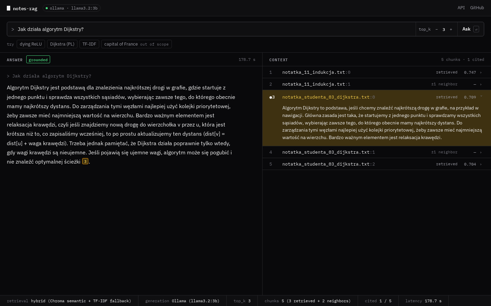
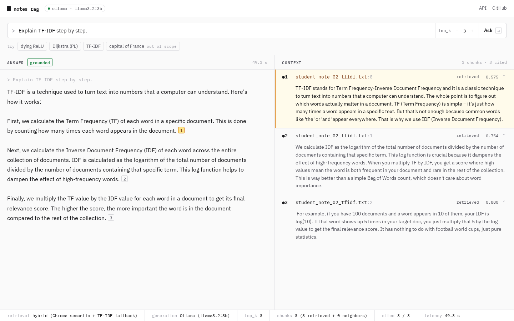
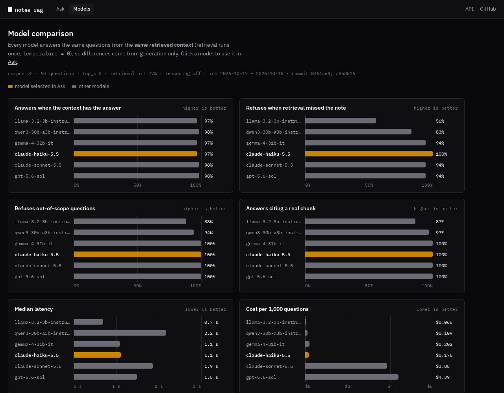
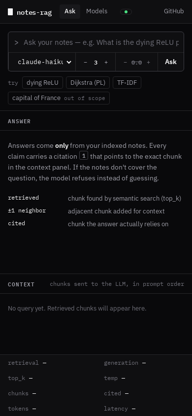
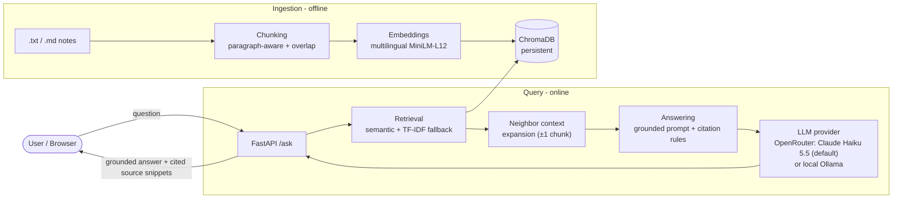
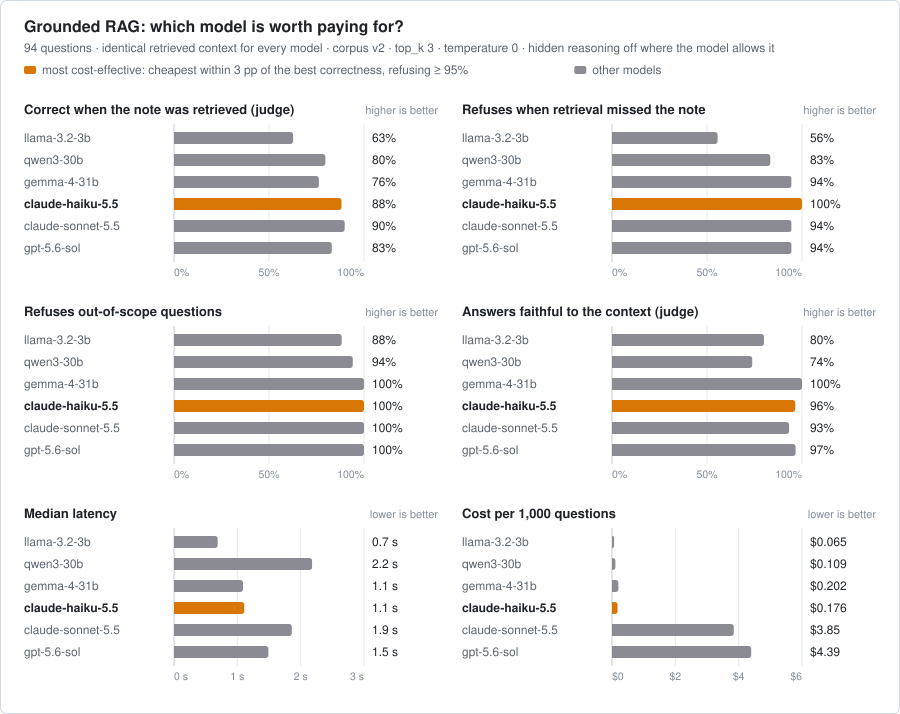
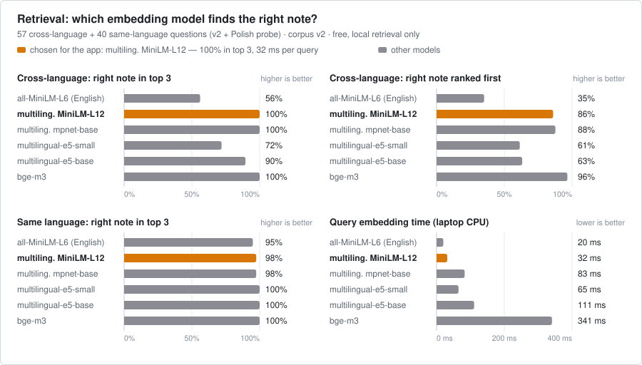
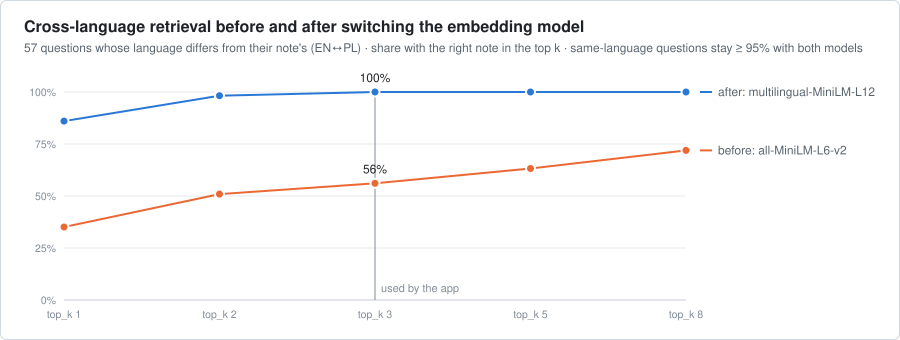
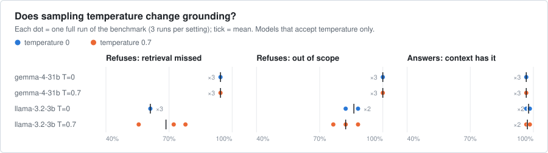

# Notes RAG Assistant

> A question-answering assistant over your own study notes. It is not a general chatbot: it answers only from indexed notes, returns source citations when answering, and refuses when the notes do not contain enough information. The LLM behind it was chosen by [benchmarking six models](#model-benchmark-which-llm-is-worth-paying-for) on grounding, cost and latency.


Repository: https://github.com/kat1478/notes-rag-assistant

---

## Demo screenshots

**Answer ↔ context.** Every citation in the answer links to the exact chunk that was sent to the LLM.
The context panel lists all chunks in prompt order — retrieved by semantic search or added as ±1 neighbors —
with their raw retrieval score; the bottom strip shows retrieval/generation mode, citation coverage and latency.







<details>
<summary>Start screen and mobile layout</summary>




</details>

---

## Why this project

This is a full Retrieval-Augmented Generation (RAG) pipeline built from scratch to explore a deliberately
hard constraint: **answers are designed to be grounded in the source notes, returning cited source snippets when answering, or the system must refuse if the information is not present.**
The notes are a mix of English and Polish CS/ML study notes, which surfaces real cross-lingual retrieval
challenges that are documented in the [Known Limitations](#known-limitations) section.

The project is built in stages, each with its own evaluation pass — retrieval quality, answer quality, and a
final validation run on previously unseen notes.

---

## Current status

This repository contains a working MVP:

- FastAPI backend with `/ask`, `/search`, `/ingest`, `/ingest/batch`, and `/health`
- persistent ChromaDB vector store
- pluggable LLM providers: OpenRouter (default model Claude Haiku 5.5, chosen by benchmark) or local Ollama
- per-request model and temperature selection, with token usage reported per answer
- static browser frontend linking each citation to its source chunk
- answer status (grounded / refused / no citation), run statistics and backend status
- smoke test for the Stage 4 application layer
- retrieval, answer-quality, and validation evaluation artifacts
- a model benchmark (6 models, 94 questions, frozen corpus) with charts and an interactive comparison view
- an LLM-as-judge for answer correctness and faithfulness, calibrated against blind human labels

The next planned technical step is Docker Compose and CI with the judge as a quality gate.

---

## Architecture



**Pipeline:** `FastAPI → chunking → embeddings → ChromaDB → retrieval (+ neighbor expansion) → LLM (Claude Haiku 5.5 via OpenRouter by default) → grounded answer with source citations`

| Layer        | Component                                                                        |
| :----------- | :------------------------------------------------------------------------------- |
| API          | FastAPI (`/ask`, `/search`, `/ingest`, `/ingest/batch`, `/health`)               |
| Chunking     | Paragraph-aware with character-level fallback and overlap                        |
| Embeddings   | `sentence-transformers` — `paraphrase-multilingual-MiniLM-L12-v2` (PL + EN)       |
| Vector store | ChromaDB (persistent, per-file upsert/delete)                                    |
| Retrieval    | Semantic (Chroma) with TF-IDF fallback + 1-hop neighbor context expansion        |
| Generation   | Provider layer: OpenRouter (allowlisted models) or Ollama; `temperature = 0.0` by default, strict grounding prompt |
| Frontend     | Vanilla HTML/CSS/JS: answer ↔ context linking, run statistics, light/dark theme  |

---

## Quickstart

### 1. Prerequisites

- Python 3.10+
- An [OpenRouter](https://openrouter.ai/keys) API key (the default model costs about $0.18 per 1,000 questions)

### 2. Install

```bash
git clone https://github.com/kat1478/notes-rag-assistant.git
cd notes-rag-assistant/backend
pip install -r requirements.txt
```

### 3. Configure the model

```bash
cp .env.example .env      # then set OPENROUTER_API_KEY=... in .env (git-ignored)
```

Optional — fully local, no key: install [Ollama](https://ollama.com/), run `ollama pull llama3.2:3b`, and set
`OLLAMA_ENABLED=true` and `DEFAULT_MODEL_ID=ollama:llama3.2:3b` in `.env` (expect ~40 s per answer on a CPU).

### 4. Add and Ingest Notes

Drop your `.txt` or `.md` study notes into the directory:

```
backend/data/notes/
```

Then index them (from `backend/`). This rebuilds the vector collection and the TF-IDF fallback from that folder.
The first run downloads the multilingual embedding model (~470 MB); re-run this after changing `EMBEDDING_MODEL_KEY`:

```bash
python -m app.ingest_corpus --corpus v1
```

### 5. Run the Backend

Start the FastAPI server:

```bash
python -m uvicorn app.main:app --host 127.0.0.1 --port 8000
```

### 6. Open the App

Navigate to **http://localhost:8000/** in your browser. The root URL automatically redirects to the static frontend. The status pill in the top bar shows `backend ready` (green dot) or `backend offline`; the model picker next to the question box lists the available models, and the **Models** tab shows the benchmark.

### 7. Run the Smoke Test

To verify the complete pipeline, run the smoke test:

```bash
python smoke_test.py
```

### 8. Verification

The smoke test has been executed and passed successfully. Example output from the run:

```
Starting Stage 4 Smoke Test against http://127.0.0.1:8000...

[PASS] GET /health - Default model: openrouter:anthropic/claude-haiku-5.5
[PASS] GET / - Resolved URL: http://127.0.0.1:8000/frontend/
[PASS] GET /frontend/ - HTML loaded successfully
Sending POST /ask ('What is ReLU?') with the default model...
[PASS] POST /ask - Answer length: 430 chars, time: 5050.5 ms

--- Summary ---
All smoke tests PASSED!
```

---

## Example

**In-scope question — answered with source citations:**

> **Q:** When should I use Bellman-Ford instead of Dijkstra?
>
> **A:** You should use Bellman-Ford instead of Dijkstra when the graph has negative edge weights, because
> Dijkstra only works correctly when all edge weights are non-negative. **[Source 2]**

The cited chunk is a Polish note (*"Dijkstra działa poprawnie tylko wtedy, gdy wagi krawędzi są nieujemne…"*) —
the English answer is grounded across languages. The UI renders citations as numbered markers; hovering or clicking
one highlights and opens the matching chunk in the context panel. (Default model, Claude Haiku 5.5, ~1 s.)

**Out-of-scope question — refused instead of guessed:**

> **Q:** What is the capital of France?
>
> **A:** I don't have enough information to answer that based on the notes.

---

## Evaluation

Evaluation is a first-class part of this project. Datasets and execution metrics are tracked under [`backend/data/eval/`](backend/data/eval/).

### a) Main Benchmark (After Stage 3D — corpus v1, local `llama3.2:3b`)

Evaluated on the 32-query benchmark dataset containing 30 in-scope (grounded) questions and 2 out-of-scope questions (measured on the final system with Ollama `llama3.2:3b` on CPU):

| Metric                                  | Result  | Details / Notes      |
| :-------------------------------------- | :-----: | :------------------- |
| **Grounded (In-Scope) Answering Rate**  | 100.0%  | 30/30 (final system) |
| **Out-of-Scope Correct Refusal Rate**   | 100.0%  | 2/2                  |
| **Source Citations Rate (On Answered)** |  93.3%  | 28/30                |
| **Average Response Time**               | ~39.0 s | 38,964.5 ms on CPU   |
| **Retrieval Hit Rate**                  | 100.0%  | 30/30                |
| **First Hit Correct Rate**              |  90.0%  | Baseline was 83.3%   |

### b) Validation on Unseen Notes

Validation pass performed on a held-out set of previously unseen notes (`notatka_11`–`notatka_15`) to test generalization capability:

| Metric                                            | Result | Details / Notes |
| :------------------------------------------------ | :----: | :-------------- |
| **Retrieval hit-rate @ k=3**                      | 81.3%  | 13/16           |
| **Grounded answered-as-expected (manual review)** | 75.0%  | 12/16           |
| **Out-of-Scope manual refusal rate**              | 100.0% | 1/1             |
| **Citation presence rate (answered)**             | 84.6%  | 11/13           |

---

## Model benchmark: which LLM is worth paying for?

**[→ Open the interactive version](https://kat1478.github.io/notes-rag-assistant/benchmark/)** — hover for details, click a
model to highlight it in every chart. It is the same view as the app's **Models** tab.

<picture>
  <source media="(prefers-color-scheme: dark)" srcset="docs/benchmark/models-dark.svg">
  
</picture>

**Setup.** Six hosted models (via OpenRouter) answered the same **94 questions** from **identical retrieved context** —
retrieval runs once per question, so differences come from generation only. `temperature = 0`; hidden reasoning is
disabled where the model allows it (Claude Sonnet 5.5 makes it mandatory, so it ran at `effort: low`). Cost is
token usage × OpenRouter list prices at run time. The corpus (v2, frozen) is the 11 original notes plus 12 synthetic
near-topic notes; 17 questions are out of scope, 12 of them traps such as *"What is Expected Sarsa?"* when only a
Sarsa note exists.

**Grounding split.** When retrieval did not return the note that holds the answer, the correct grounded behaviour is to
refuse — so those 18 questions are scored as refusal tests, not answer tests.

| Model | Correct — note retrieved (judge, n=59) | Faithful to context (judge) | Refuses — retrieval missed (n=18) | Refuses — out of scope (n=17) | Median latency | $ / 1k questions |
| :--- | ---: | ---: | ---: | ---: | ---: | ---: |
| llama-3.2-3b | 63% | 80% | 56% | 88% | 0.7 s | $0.06 |
| qwen3-30b | 80% | 74% | 83% | 94% | 2.2 s | $0.11 |
| gemma-4-31b | 76% | 100% | 94% | 100% | 1.1 s | $0.20 |
| **claude-haiku-5.5** (default) | 88% | 96% | 100% | 100% | 1.1 s | $0.18 |
| claude-sonnet-5.5 | 90% | 93% | 94% | 100% | 1.9 s | $3.85 |
| gpt-5.6-sol | 83% | 97% | 94% | 100% | 1.5 s | $4.39 |

Correctness and faithfulness are graded by an LLM judge that was checked against human labels — see
[Is the judge trustworthy?](#is-the-judge-trustworthy) below.

**What I took from it**

- **Every model *answers* 97–98% of the time — what separates them is whether the answer is right and grounded.**
  Judge-verified correctness ranges from 63% (Llama 3.2 3B) to 90% (Claude Sonnet 5.5); Qwen3 30B answers well but adds
  claims the context doesn't support in a quarter of its answers; Gemma 4 31B is perfectly faithful but less complete.
- **Knowing when not to answer matters as much.** The 3B model answers without a source in almost half of the cases where
  retrieval missed the note.
- **Claude Haiku 5.5 became the app's default:** rule — the cheapest model within 3 pp of the best correctness that also
  refuses ≥ 95% of the time. Haiku: 88% correct (Sonnet 90%), 96% faithful, 100% correct refusals, ~1 s, $0.18 per 1,000
  questions — roughly 1/22–1/25 of the cost of Claude Sonnet 5.5 and GPT-5.6 Sol, which scores lower (83%) here.
- **Local `llama3.2:3b` (Ollama) is left out:** 5–110 s per answer on my laptop CPU rules it out as a product option.
  The same model, hosted, is in the chart; local inference can still be enabled with `OLLAMA_ENABLED=true`.

### Is the judge trustworthy?

The judge (GPT-5.6 Luna, structured JSON, reasoning off) grades each answer against the dataset's expected key points
and the retrieved context. I labelled a **blind, stratified sample of 25 answers** myself (no model names, no judge
grades) in a small labelling page, then compared:

| | Judge v1 | Judge v2 (final) |
| :--- | ---: | ---: |
| Correct vs. not correct — agreement | 84% | 84% |
| 3-class verdict — agreement (Cohen's κ) | 76% (0.50) | 76% (0.50) |
| Faithfulness — agreement | 80% | 84% |

- **v1 → v2:** every answer the v1 judge flagged as unfaithful was a false alarm — English claims vs. Polish evidence.
  v2 must quote the supporting passage for each claim (in any language) or leave it empty; 97% of its quotes occur
  verbatim in the context, so it isn't inventing evidence. I stopped there rather than tune the prompt to 25 examples.
- **Direction of errors:** the judge is *stricter* than me — it never called an answer correct that I rated lower.
  Several disagreements trace back to the dataset, not the judge (e.g. a question whose key points require saying
  "this is outside the notes"), and one to a rubric gap: an answer in the wrong language isn't penalised.
- **Bias:** GPT-5.6 Luna (OpenAI) also grades GPT-5.6 Sol; Sol scoring *below* Claude here suggests no strong
  family preference, but a second judge would be needed to rule it out.

Judge cost for all 359 graded answers: about $0.18.

### Prompt iteration: answering in the question's language

The original grounding prompt told the model *"the question is in English"*. Claude Haiku obeyed it and answered
Polish questions in English, while Llama 3.2 3B drifted the other way — into the notes' Polish on half of the
English questions. I measured three prompt versions on the 94 benchmark questions plus a **Polish probe set**
(23 benchmark questions translated to Polish), with a deterministic language check and the LLM judge:

- **v2** — "the question may be in either language": fixed Polish questions, but primed Haiku into Polish on 5
  English questions and confused Llama 3B. Rejected.
- **v3** — the app detects the question's language and states it (*"The question is in Polish. Write the whole answer
  in Polish."*), with one refusal sentence in that language. **Adopted as the default.**

| Model (v1 → v3) | Same language — English questions | Same language — Polish questions | Correct — English | Correct — Polish |
| :--- | ---: | ---: | ---: | ---: |
| **claude-haiku-5.5** (default) | 95% → 99% | 35% → 100% | 88% → 88% | 82% → 91% |
| qwen3-30b | 96% → 100% | 44% → 100% | 80% → 86% | 91% → 100% |
| llama-3.2-3b | 50% → 90% | 96% → 100% | 63% → 73% | 73% → 64% |

Haiku's faithfulness and refusal scores dip slightly under v3, but on inspection those are measurement artefacts:
the judge counts hedges such as *"the notes do not explicitly state…"* as claims, and soft refusals (*"the notes do not
mention who invented A\*"*) don't match the fixed refusal sentence the scorer looks for. The published model table
above still uses prompt v1, so all six models stay comparable. Experiment cost: about $0.30. Reproduce with
`python -m app.compare_prompts` after running `run_model_benchmark --prompt v1|v2|v3`.

### Multilingual embeddings: closing the cross-language gap

The retrieval bottleneck was the English-only embedding model: an English question about a Polish note found the right
note only 56% of the time at `top_k = 3`. I compared six embedding models on retrieval
alone (free, local, same chunks and the same file-level hit as the benchmark; the old model reproduces the
benchmark's misses exactly):

<picture>
  <source media="(prefers-color-scheme: dark)" srcset="docs/benchmark/embeddings-dark.svg">
  
</picture>

<picture>
  <source media="(prefers-color-scheme: dark)" srcset="docs/benchmark/retrieval-topk-dark.svg">
  
</picture>

- **Chosen: `paraphrase-multilingual-MiniLM-L12-v2`** — cross-language hits at `top_k = 3` go from
  56% to 100%, same-language ones stay high
  (95% → 98%), for ~32 ms per query on a laptop CPU.
- `bge-m3` ranks even better (the right note first in 96% of cross-language
  questions) but costs ~341 ms per query and a 2 GB model; with only 3 chunks used, ranking beyond the top 3
  doesn't change the answer. The e5 family underperformed cross-lingually despite its query/passage prefixes.
- Each embedding model gets its own vector collections: both models output 384-dimensional vectors, so sharing a
  collection would have mixed them silently. The old model stays selectable (`EMBEDDING_MODEL_KEY=minilm-l6`) to
  reproduce the published model table.

**End to end** (Claude Haiku 5.5, prompt v3, judge-verified) — share of *all* in-scope questions answered correctly:

| | English-only embeddings | Multilingual embeddings |
| :--- | ---: | ---: |
| Benchmark questions | 52/77 (68%) | **72/77 (94%)** |
| Polish probe | 11/20 (55%) | **20/20 (100%)** |

Questions refused because retrieval missed the note dropped from 18 to 1;
out-of-scope refusals are unchanged (94%). Cost of the end-to-end check: about $0.07.

### Parameters tested

<picture>
  <source media="(prefers-color-scheme: dark)" srcset="docs/benchmark/temperature-dark.svg">
  
</picture>

**Temperature 0 vs 0.7, three full runs each.** Gemma 4 31B gives the same answer and refusal rates in all six runs
(only one citation differs). Llama 3.2 3B varies by up to 22 pp *between repeated runs* at temperature 0.7 — and by up
to 6 pp even at temperature 0, because hosted endpoints are not bit-deterministic. Takeaway: with a small model,
single-run differences below ~10 pp are noise.

### What the benchmark caught along the way

- **Refusals in another language.** The model often refuses in Polish (*"Nie ma w tym tekście informacji…"*) instead of
  the fixed English sentence, which the scorer counted as an answer. Fixed the detector and added `--rescore`, which
  recomputes saved runs without new API calls.
- **Corpus drift.** An out-of-scope question from the May evaluation (*"What is Bellman-Ford used for?"*) turned into a
  hallucination trap after a Q-learning note mentioning "Bellman" was added. Hence a frozen corpus per benchmark version;
  old results stay valid for their own corpus.
- **Reasoning is not always optional.** Claude Sonnet 5.5 rejects disabling it (HTTP 400); the client now falls back to
  the lowest effort and records the setting per run.
- **Latency hygiene.** A laptop that went to sleep mid-run inflated latencies; the benchmark now detects host
  suspension and excludes those timings, and warms local models up before timing.
- **Guardrails:** a model allowlist, a `--max-cost-usd` budget guard, and an abort if the context comes from the wrong
  corpus. Total API spend for everything on this page, including the judge and both experiments: about $1.70.

**Reproduce** (from `backend/`, with `OPENROUTER_API_KEY` in `backend/.env`):

```bash
python -m app.ingest_corpus --corpus v2                              # build the v2 vector collection
python -m app.run_model_benchmark --corpus v2 --retrieval-only       # free: retrieval hit rates
python -m app.run_model_benchmark --corpus v2 --max-cost-usd 5       # all allowlisted models
python -m app.run_model_benchmark --corpus v2 --temperature 0.7 --run-tag r1 \
       --out-dir data/eval/v2/temperature --models openrouter:google/gemma-4-31b-it
python -m app.run_judge --max-cost-usd 2                             # LLM judge on the saved answers (cached)
python -m app.judge_calibration build                                # blind labelling page for a 25-answer sample
python -m app.judge_calibration score <labels.json>                  # human vs. judge agreement
python -m app.compare_embeddings                                     # free: embedding-model retrieval comparison
python -m app.render_benchmark_charts                                # charts + interactive page → docs/benchmark/
```

**Limits.** Correctness comes from an LLM judge with 84% agreement to one human labeller on 25 answers — good enough
to rank models that differ by ~10 pp, not to separate Haiku from Sonnet (2 pp). The 12 added notes are synthetic, and
n is small: one question is 1.7–6 pp.

---

## Known Limitations

Based on validation run insights, the system has the following limitations:

- **Cross-lingual retrieval (largely fixed):** the original English-only embedding model missed Polish notes for English questions (56% found at top_k 3). The multilingual model finds them 100% of the time on the v2 benchmark; a larger, real corpus would be needed to confirm this holds beyond 23 notes ([details](#multilingual-embeddings-closing-the-cross-language-gap)).
- **Context fragmentation:** The 1-hop neighbor expansion (±1 chunk) misses relevant information lying 2+ chunks away from the primary hit.
- **Latency / model limitations (local mode):** The small model (`llama3.2:3b`) running on CPU is slow (averaging ~39.0 seconds per response) and sensitive to prompt/context size. Under large context sizes, it can become overly cautious and refuse to answer even when the answer is present in the context. Note: The first query after startup may take 30-45+ seconds as Ollama loads the model into memory; subsequent queries are faster.

For a full failure analysis, see [`validation_summary.md`](backend/data/eval/validation_summary.md) and the Stage 3D comparison docs in [`backend/data/eval/`](backend/data/eval/).

---

## Project structure

```
backend/
  app/
    main.py            # FastAPI app + endpoints
    chunking.py        # paragraph-aware chunking
    embeddings.py      # sentence-transformers wrapper
    vector_store.py    # ChromaDB persistence
    retrieval.py       # semantic + TF-IDF fallback + neighbor expansion
    answering.py       # grounding prompt + citation rules
    provider.py        # LLM providers (OpenRouter, Ollama), model allowlist
    llm_client.py      # thin facade over the providers
    run_retrieval_eval.py / run_answer_eval.py
    run_model_benchmark.py / render_benchmark_charts.py / ingest_corpus.py
    run_judge.py / judge.py / judge_calibration.py     # LLM-as-judge + human calibration
    compare_prompts.py / compare_embeddings.py         # prompt and embedding-model experiments
  data/
    notes/             # sample study notes (corpus v1, indexed by the app)
    notes_v2/          # frozen benchmark corpus: v1 notes + 12 synthetic near-topic notes
    eval/              # evaluation datasets, results, and analysis (eval/v2/: model benchmark)
frontend/              # vanilla HTML/CSS/JS UI (Ask + Models views)
docs/benchmark/        # README charts + static interactive benchmark page (GitHub Pages)
```

---

## What makes it more than a chatbot?

- It separates retrieval evaluation from answer evaluation.
- It refuses when the notes do not contain enough information.
- It exposes retrieved source chunks instead of hiding them.
- It includes a validation run on unseen notes.
- It ships with a local frontend and smoke test, not only an API endpoint.
- Its model was picked by a reproducible benchmark, not by default.

---

## Roadmap / Next steps

- [x] **OpenRouter provider + model benchmark** — six models compared; Claude Haiku 5.5 chosen as default ([results](#model-benchmark-which-llm-is-worth-paying-for)).
- [x] **LLM-as-judge** — correctness + faithfulness graded by GPT-5.6 Luna, calibrated on 25 blind human labels ([details](#is-the-judge-trustworthy)).
- [ ] **Reranking** — add a cross-encoder reranker over the top-k candidates to improve answer precision.
- [ ] **Hybrid search** — combine dense (embeddings) with sparse (BM25) retrieval instead of TF-IDF fallback.
- [x] **Multilingual embeddings** — cross-language retrieval 56% → 100% at top_k 3; correct answers 68% → 94% end to end ([details](#multilingual-embeddings-closing-the-cross-language-gap)).
- [ ] **Docker Compose** — one-command, reproducible setup.
- [ ] **API authentication** — protect the endpoints for any non-local deployment.
- [ ] **Deployment** — host the API + a small managed vector store.
- [ ] **Unit tests** — `pytest` coverage for chunking and retrieval beyond the smoke test.

---

## License

Released under the [MIT License](LICENSE).
